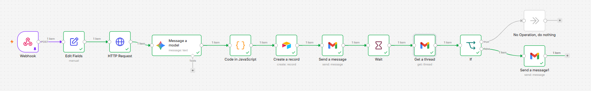

# Lead Automation, AI Scoring & Smart Follow-up (n8n)

## Overview
This n8n workflow automates the entire lead management process from capture to follow-up. It is designed to save time, ensure no lead falls through the cracks, and only send follow-ups to prospects who haven't replied.

## Workflow Preview

## How the Workflow Works
1. **Webhook Trigger:** Captures incoming lead data (Name, Email, Company, Message) from forms like Typeform or Google Forms.
2. **Data Enrichment:** An `HTTP Request` node fetches additional company data via API.
3. **AI Scoring:** An AI model (OpenAI) analyzes the enriched data to assign a lead score (0-100) and a reason for the score.
4. **Database Sync:** Saves the lead, enriched data, and score to a CRM/Airtable.
5. **Welcome Email:** Sends an immediate, personalized email to the lead.
6. **Smart Wait:** Pauses the workflow for 3 days (configured via the `Wait` node).
7. **Reply Detection:** Uses the Gmail API to check the specific email thread for any new messages from the lead.
8. **Conditional Follow-up:** 
   - If the lead **replied**, the workflow routes to a `No Operation` node and ends.
   - If there is **no reply**, it routes to a second Gmail node to send a gentle follow-up email.

## Prerequisites
To use this workflow, you will need:
- An n8n instance (Cloud or Self-hosted).
- API Credentials for your chosen Enrichment provider (e.g., Apollo, Agify).
- An OpenAI API Key (for the AI scoring node).
- An Airtable account (or adjust the node for HubSpot/Google Sheets).
- A Gmail account connected to n8n.

## Setup Instructions
1. **Download the JSON:** Download the `.json` file from this repository.
2. **Import to n8n:** Open your n8n canvas, click the `...` menu in the top right, and select **Import from File**.
3. **Configure Credentials:** Open each node (HTTP Request, OpenAI, Airtable, Gmail) and select or create your credentials.
4. **Test the Flow:** 
   - Change the `Wait` node to `1 minute` for testing.
   - Copy the Webhook URL and send a test POST request.
   - Verify that the thread logic works by testing both "reply" and "no reply" scenarios.

## Skills Demonstrated
`Webhooks` · `HTTP Requests (APIs)` · `Data Mapping` · `AI Integration` · `Time Delays (Wait)` · `Conditional Logic (If Nodes)` · `Email Automation`